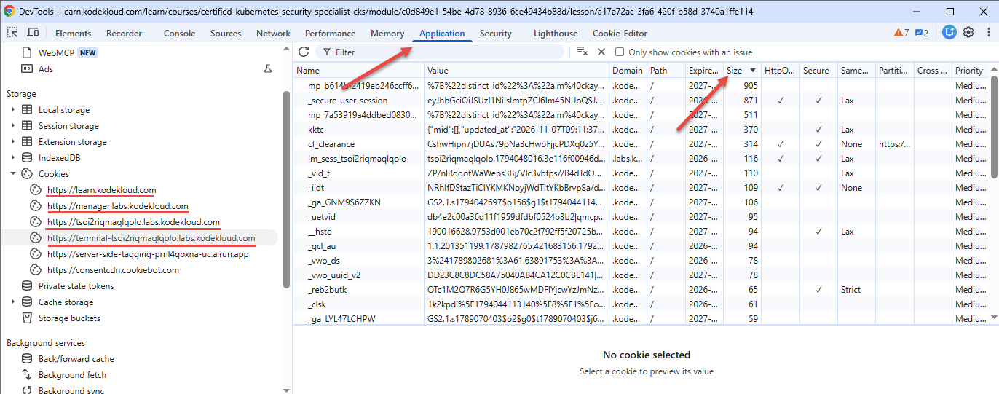

# Lab Issues

* [Unable to access labs from Udemy course](#unable-to-access-labs-from-udemy-course)
* [Question options are all marked incorrect](#question-options-are-all-marked-incorrect)
* [Labs Disconnecting/Crashing](#labs-disconnectingcrashing)

For all lab issues that are not related to login problems, the primary channel for getting further information is our Discord server, so this is where you should go for further information and status updates.

## Unable to access labs from Udemy course

We provide a free enrolment coupon for labs on the Udemy courses. Please check the steps here: https://support.kodekloud.com/udemy-students-unable-to-access-labs. When creating an account on kodekloud.com as required, be sure to use the same email address you used for your Udemy account.

If you are still having an issue, please get in touch with the support team: support@kodekloud.com

## Question options are all marked incorrect

This is an intermittent issue. In such cases, please reload the browser page and redo the question. You don't need to stop/reset the lab. After reloading, it should pick up where you left off. So you can select the correct option for this question again and it should work.

Should this fail to resolve the issue, please report Discord, including a link to the lab and the question number.

## Labs Disconnecting/Crashing

You're probably reading this because you've experienced labs that are crashing, not loading, giving nginx error codes, slow or other similar reasons.

First off, let's rule out any potential browser issues. If you are new to the labs, this could be the issue. Please read and try out the tips here: https://support.kodekloud.com/troubleshooting-labs. Also browser-related is an error that contains the text
```text
400 Request Header Or Cookie Too Large
```
If you see this anywhere in the error message, then please see the section about this at the end of this document.

If the labs are still not working, there are a number of reasons this may be happening. To provide the labs, we rely on Cloud-based infrastructure and various other third party services, such as content distribution network (CDN) providers and the like which are not under our control. Any of these pieces in the puzzle could be having an issue, meaning that if it is not something under our control, we all have to wait until the third party fixes their issue.

If you are in the middle of a lab and the terminal screen shows an nginx 404/502/504 error or a "connection closed" error, then sometimes this can clear by opening a new terminal tab after a minute or so.

Additionally, we have tens of thousands of students enrolled in courses at any one time. There is only so much infrastructure to go round. It may be that you've hit a busy time, so you should wait a few minutes and retry. If still broken, wait 30 min to an hour before retrying. Even Cloud providers (which we rely on) have periods where infrastructure cannot be provisioned due to excessive demand. Issues may also be regional. What works for a user in one part of the world may not work in another. This can be attributed to regional third party services such as CDN or Cloud Provider issues (outside our direct control).

When it is the case that the issue is with our own platform or infrastructure, or if we know where the cause is elsewhere, there will generally be announcements made on our Discord server, so you should check there for updates and fix ETAs.

Either way, you should try reloading the lab immediately, after a few minutes and if that does not work, after an hour or so. For the most part, many of these issues including labs not loading are transient and fix themselves. Only if you are still getting the same error after an hour should you report it.

The key takeaway from this is that the issues you may be facing are not always something that is our fault, therefore not something that can be fixed immediately.

We thank you for your patience.

# Request Header Or Cookie Too Large

We have an active investigation on this issue, and request your assistance in solving it. If you get this error, please get screenshots of your site cookies related to KodeKloud sorted by size from Developer Tools in the browser and then attach them to your message in Discord and post in the `feedback-bugs-features` or `support-help` channels. Once you have posted the message and screenshots, then clear your cookies to retry the lab. The information we need from this is the `Name` and the `Size` of the cookies, not the value. Make the value column narrower if an entire value is showing, which it might be for ones with a small size. Make the `Name` column wider if any of the names are truncated (have `...` at the end). Either way we're trying to find the really big ones.

1. Open Developer Tools
1. Select `Application` as indicated by the arrow (see screenshot below)
1. For each URL containing `KodeKloud` on the left, click it, sort the table by Size, largest first (other arrow)
    1. Take screenshot

Always include a reference to the lab:
* Course labs - copy link from browser, and say which question number it happened in.
* KodeKloud Engineer - The course, level and lab title, e.g. `Linux Level 1, Custom Apache User Setup`
* 100 days challenges - The course and day number, e.g. `100 days of cloud, day 47`

Please note that this procedure applies *specifically* to errors that look like

```text
Oops! There is an error with reading the question.

<html>\r\n<head><title>400 Request Header Or Cookie Too Large<title> ...
```



