# SSH mini-FAQ

* [What is SSH?](#what-is-ssh)
* [Changing SSH server settings](#changing-ssh-server-settings)
* [Debugging connection to AWS EC2 instances](#debugging-connection-to-aws-ec2-instances)
* [Debugging connection to Azure VMs](#debugging-connection-to-azure-vms)
* [Connecting to cloud instances from lab terminal](#connecting-to-cloud-instances-from-lab-terminal)
* [Inserting SSH keys for root user](#inserting-ssh-keys-for-root-user)
* [SSH connections in a network of servers (hosts)](#ssh-connections-in-a-network-of-servers-hosts)

## What is SSH?

SSH, which stands for Secure Shell, is a technology that allows you to safely connect to and control a remote computer or server over the internet. Think of it like a secure, invisible tunnel that connects your device to another one, ensuring that everything you type or send is completely encrypted so hackers cannot spy on it. Once the connection is made, it opens up a text-based window where you can run commands and manage files as if you were sitting right in front of that remote computer. It is widely used by developers and website owners because it replaces older, unsafe connection methods that could easily leak passwords. To keep things safe, it usually verifies who you are by using either a traditional password or a special digital "key pair" stored on your machine.

It consists of
* A server process `sshd` which runs on the remote computer that listens for connection requests from...
* A client process `ssh`, which is the command you run when you want to connect to a remote computer.

## Changing SSH server settings

This comes up time and time and time again in the forums! For instance:

> The question asks to disable root login. I set `PermitRootLogin no` yet the task is failing

When you change any settings in the `sshd_config` file, the settings are not applied *until you restart the `sshd` service*! The grader tests your changes by attempting to ssh to the lab terminal (or cloud instance), so if your changes are not *applied*, the grader doesn't find what it is looking for.

Do
```bash
sudo systemctl restart sshd
```

This causes `sshd` to read and apply the new settings. Then the task will pass.

For those that wonder why restarting the `sshd` service does not drop your ssh connection and disconnect you. The `sshd` process exists to listen for new connections. When a connection is made, it's connected according to the settings in `sshd_config` that were active when the connection was initiated. `sshd` creates a new, separate process to handle that connection until you close your connection. This allows you to safely restart the service without dropping your connection, and the new settings apply to connections started after the service restart.

### Gotchas

Note that it is not an error if the same configuration parameter appears more than once in `ssh_config` file, therefore you need to be aware of what will happen.

```text
PermitRootLogin yes
PermitRootLogin no
```

`sshd` will not error if it sees this in the file. What actually happens is that it will use the *first* occurrence of the parameter and ignore subsequent ones. In the above example, the server will *ALLOW* root logins!


## Debugging connection to AWS EC2 instances

Students often have issues connecting to EC2 instances from labs or KKE/100 days tasks. This section will go through what is needed to connect.

### Connecting from AWS console

Often to begin a task, you will need to connect directly from the AWS console first. This may be to insert an SSH public key that you have created using `ssh-keygen` in the lab console. There are a few things that must be correctly lined up to be able to do this.

1. The instance should be *fully* started. Check the `Status` column in the EC2 console and ensure it is `2/2 checks passed`. Wait until this is the case.

    <details>
    <summary>Image</summary>

    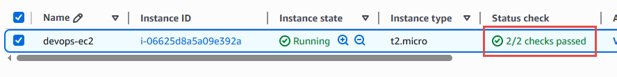

    </details>
1. The instance *must* have a security group that allows inbound access from `0.0.0.0/0` on *at least* port 22, or `All` will do (less secure, but will work),
    <details>
    <summary>Image</summary>

    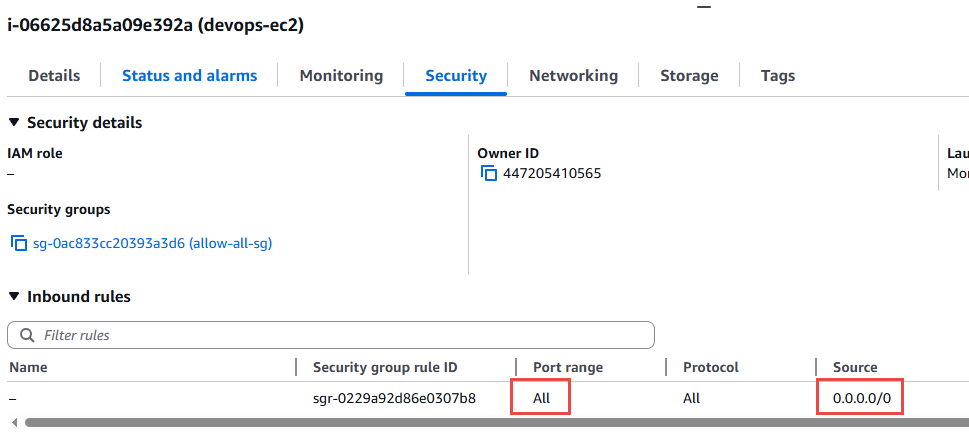

    </details>
1. The instance *must* have a Public IP

    <details>
    <summary>Image</summary>

    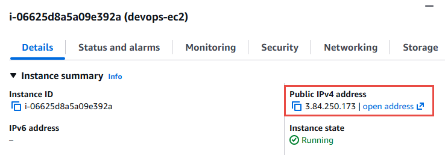

    </details>
1. The subnet it is connected to *must* have a route to the Internet Gateway.
    1. Click the small squares next to `VPC ID` and `Subnet ID` to copy values, paste these to your notepad

        <details>
        <summary>Image</summary>

        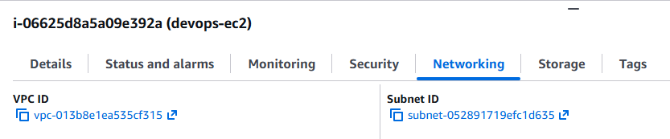

        </details>
    1. Go to VPC console
    1. Select the VPC with the ID you copied (in nearly all labs there is only one VPC)
    1. Check the VPC `Resource Map`. It looks like this

        <details>
        <summary>Image</summary>

        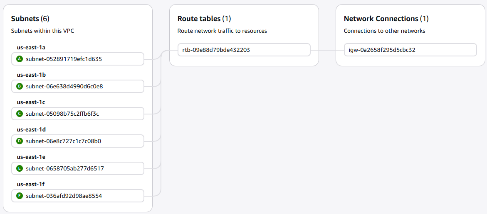

        </details>
    1. Verify that the subnet ID you coped is in the list on the left and that you can trace a line through `Route tables` to `Network connections` and that the network connection begins with `igw`, which indicates the Internet Gateway.

If all the above is true, then you can connect to the instance using EC2 Instance Connect.

For some KKE tasks you have to create a VPC. *You* have to ensure as part of that task if instances within the new VPC are to be able to be contacted from the lab terminal that all the above is set up when you create the VPC, subnet and route table. These concepts should be familiar if you have done the [AWS Certified CloudOps](https://learn.kodekloud.com/courses/aws-certified-sysops-administrator-associate) course.

### The keypair store

In the EC2 console, there is a store for pre-created SSH keypairs (`Key Pairs` on the left menu). There are a few ways to add new key pairs to this
* `Create key pair` from within the console.
* From the `Launch an Instance` screen
* By creating yourself with `ssh-keygen` and uploading it via `aws ec2 import-key-pair`

Either way, when a named keypair from this store is used to launch an instance, that keypair will be assigned to the *default user account* for the instance, i.e. `ec2-user`, `ubuntu` etc, but never `root`. If a lab question asks you to assign keys to the `root` user, there will always be a manual step to copy the public key to `root`'s `authorized_keys` file. See also [Inserting SSH keys for root user](#inserting-ssh-keys-for-root-user).

## Debugging connection to Azure VMs

Ensure that:
* The VM must be Linux and be be *fully* started

    <details>
    <summary>Image</summary>

    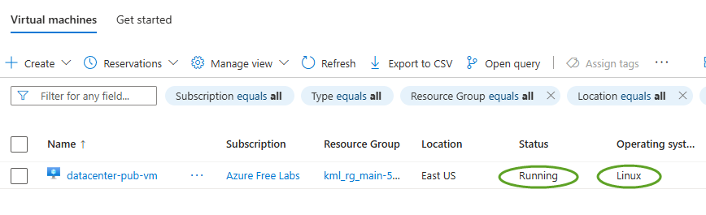

    </details>
* The VM has a public IP bound to it

    <details>
    <summary>Image</summary>

    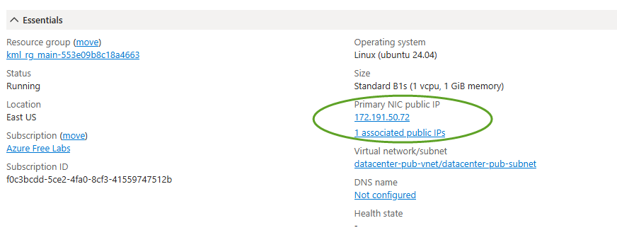

    </detals>
* The VM's NIC is associated with a Network Security Group that permits inbound access on port 22 with source `0.0.0.0/0` and destination `Any`

    <details>
    <summary>Image</summary>

    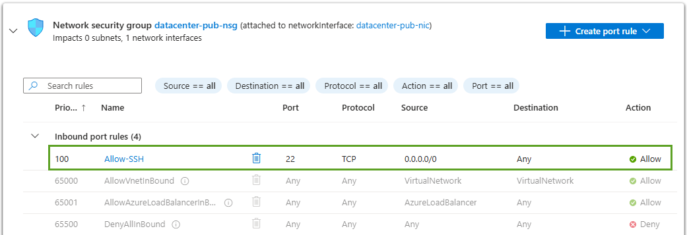

    </details>


## Connecting to cloud instances from lab terminal

Everything in the above section (AWS or Azure as appropriate) must be true to ensure SSH access from the outside world will work. Connection from the lab terminal will either be
* Via SSH key pair which you created from the Cloud
console, in which case that will have downloaded a PEM file either to your laptop (open the file, and paste the content to a new file *on the lab terminal*), or via a PEM file that is pre-created in the lab terminal. With either of these, use `ssh -i <PEM>` where PEM is the path to the PEM file name.
* Via ssh keys you created using `ssh-keygen` on the lab terminal. When using this method, *ALWAYS* accept the defaults for the key names (`id_rsa`) unless the question specifically says otherwise, else the grader will fail you.
    ```text
    azure-client ~ ➜  ls -l ~/.ssh
    total 12
    -rw------- 1 root root  562 Sep 18 03:49 authorized_keys
    -rw------- 1 root root 3243 Sep 18 04:00 id_rsa
    -rw------- 1 root root  725 Sep 18 04:00 id_rsa.pub
    ```

When you use `ssh-keygen`, you must copy the content of the created `id_rsa.pub` to the cloud instance's `authorized_keys` file as directed by the question.
* On AWS you can use EC2 Instance Connect to make the initial connection to EC2 to perform the copy if the instance already exists.

## Inserting SSH keys for root user

Some of our cloud labs request that you set up password-less root access to an EC2 instance or an Azure VM, by first creating a keypair using `ssh-keygen` in the lab terminal and then to put it into the cloud instance root user's `authorized_keys` file.

A common mistake is not noticing what is *already present* in the `authorized_keys` file and simply appending the new public key to what's already there. Then when trying to SSH as root to the instance you will get a response like this

> Please login as the user '*some-other-user*' rather than the user 'root'

OK, what just happened? Under normal circumstances you shouldn't allow root access over SSH, even with keys only. If you look closely at the content of root's `authorized_keys` it will look something like this:

```
command="echo 'Please login as the user '\''some-other-user'\'' rather than the user '\''root'\''.'; sleep 2; exit 1",no-agent-forwarding,no-port-forwarding,no-pty,no-user-rc,no-X11-forwarding ssh-ed25519 AAAAC3NzaC1lZDI1NTE5AAAAIBExamplePublicKeyDataHere user@example
```

What this does:

* `command="..."`

    Forces execution of the message command instead of granting a shell.
* `no-pty`

    Prevents allocating a terminal.
* `no-port-forwarding, no-agent-forwarding, no-X11-forwarding`

    Disables SSH forwarding features.
* `no-user-rc`

    Prevents execution of ~/.ssh/rc.

While this is still present, root logins will not work. To make root logins work, you must *remove* this and *replace* it with the public key you generated.

For cloud instances, if the key you intend to use has already been inserted for the default user (e.g. `ec2-user`, `ubuntu`, `azureuser` etc.), simply SSH to the VM as that user, then copy the file to root which overwrites what was already there with your key:

```bash
sudo cp ~/.ssh/authorized_keys /root/.ssh/
```

Key thing for these questions is that the following must work for you, because that's what the grader will also do. Replace `<ip-of-cloud-instance>` with the IP address you have for the instance/VM.

```bash
ssh root@<ip-of-cloud-instance>
```

## SSH connections in a network of servers (hosts)

It is a common misconception of students and the cause of many questions on the forum that one should just keep using `ssh` to jump from host to host. For instance:

> In the lab, I did `ssh db` to get to DB server from web server. Now I try `ssh web` to return to web server and it is asking for password. What is the password?

It is asking for a password because `ssh` is not configured for that direction. The correct way to return to web server is to type `exit` (or press `CTRL-D`) which essentially reverses the `ssh` connection you made.

If you later try [KodeKloud Engineer](https://engineer.kodekloud.com/), there are many servers. The start server is called `jump-host`.  You always `ssh` to one server, `exit` back to `jump-host` then `ssh` to another server. In some labs such as Kubernetes Ultimate Mocks series, this may be called `student-node`. Either way it's still the start server - the one you land on when the lab first starts, and the one you must *always* `exit` back to before attempting to `ssh` to any other server.

Why is it done this way? It is a security and operational best practice and is how it is done in the real world, not just labs. Every SSH connection requires a key pair, so if you could `ssh` from any host (server) to any other host in any direction on a network with `n` hosts, the number of key pairs that would have to be managed can be calculated using the formula `n(n-1)` which even with 10 servers on the network is 90 key pairs - per user who has access to all servers!

Note that in the real exams, ssh is also set up this way (because it's the industry standard way to do it). The jump host is normally called something like `candidate-node`, either way it is the node you are on when you open the terminal app. Always `exit` back to this node at the end of a question so you can ssh to another node in the next question. Some questions e.g. in Kubernetes exams may require you to ssh to a control plane and *from there* ssh to a node of that cluster. This is also normal. You would `exit` once back to the control plane and then `exit` again to the candidate node. This is a tree arrangement where the control plane node acts as the jump host to the nodes of that cluster.

Jump hosts are often referred to as "bastion" servers. You will see this term come up in some of the other courses.

Let's look at this in pictures

### Spider's web SSH

With just 5 hosts here the number of possible SSH routes here using the formula is 20. Therefore to sustain this network I must update the `authorized_keys` file on every host with the public key of every other host, and if I add one more host, that is a lot of edits I have to do, as all the existing hosts now need to know the public key of the new host and the new host needs all the public keys of the existing hosts! Consider when the network becomes 100 servers (not uncommon). That's now 9,900 edits!!

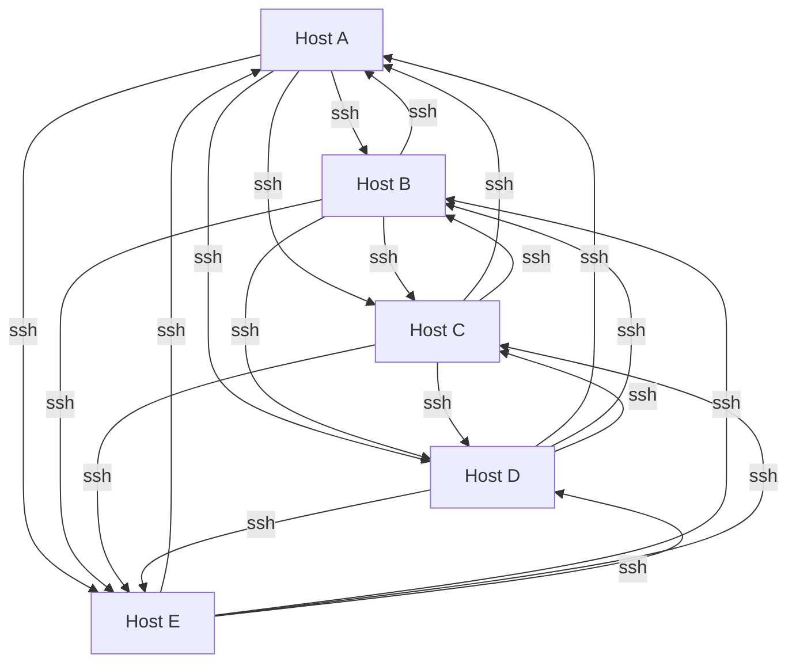

### Hub and spoke using a bastion

The number of routes is 4. You can use a single keypair with the public key copied to each of hosts A thru D, or to be more secure, 4 keypairs, one for each host. If I add one more server, then I only have to update the `authorized_keys` file on the new host to add the public key for `jump host`.

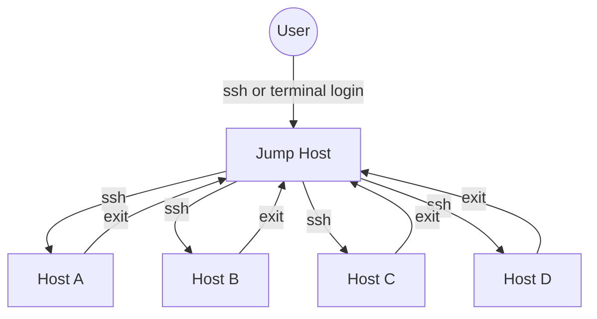

### Lab Examples

#### KodeKloud Engineer

Not all infrastructure is shown, but the remaining servers are all connected the same way to `jump-host`

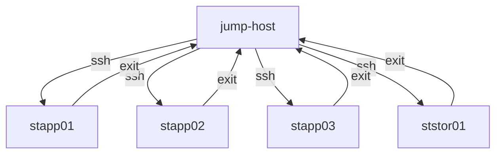

#### Kubernetes Ultimate Mocks

Not all infrastructure and routes are shown, but the remaining cluster nodes are connected the same way. This is an example of a **tree** configuration. Each control plane acts as the jump host for its worker node(s). `student-node` is the jump host to each control plane node.

Routes marked with ❌ are not possible because they have not been configured with ssh keys. If you attempt a connection this way, `ssh` will ask for a password, which you don't have! If you've read everything above, you will understand that this is *purposely by design*.

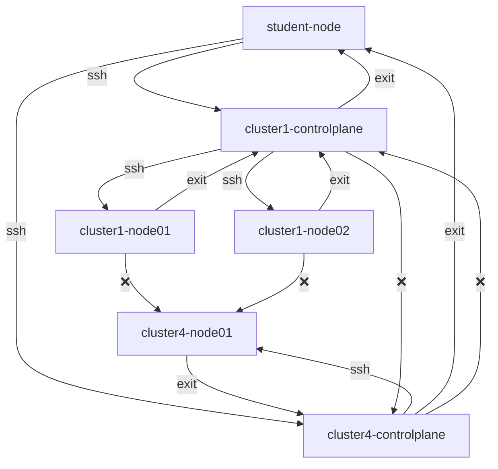


## Terminology

If the concepts of ssh keys, bastions and `authorized_keys` are new to you, these are covered in other courses where management of SSH connections is covered such as [Linux Basics](https://learn.kodekloud.com/courses/learning-linux-basics-course-labs) and [LFCS](https://learn.kodekloud.com/courses/linux-foundation-certified-system-administrator-lfcs).
